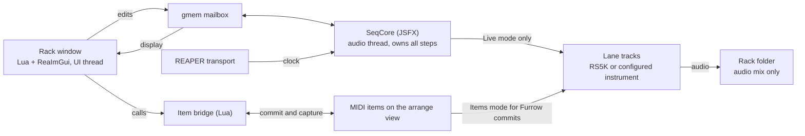

# Furrow: Spec and Architecture

Oct 10, 2026 · No Chaserz

**Status.** Revised on 11 October 2026 after the first milestone 1 probes on REAPER 7.82 for Linux. Routing, constant-tempo timing, tempo ramps, tempo steps on the beat grid, native undo of an acknowledged engine edit, and save and reload of the origin and seed encoding passed. Named gmem scope and size, the host lifecycle around bypass, offline, project tabs and held notes, and RS5K's response to notes, velocity and controllers were measured. Item extension data kept snapshots up to 8 MiB through copies, undo and save and reload. The evidence is in `probes/results/reaper-7.82-linux/`. Other REAPER-dependent behavior remains unverified, and Windows and macOS have not run. The rack, page allocator and item bridge must wait for their stated gates.

## Overview

Furrow is an FL Studio-style step sequencer built natively for REAPER. It pairs a JSFX engine that keeps sample-accurate time with a Lua/ReaImGui rack window that manages tracks, samplers and MIDI items. This plan follows the earlier [research report](https://claude.ai/artifact/F8UQLiAWiqPRsWVGxbca1a).

The name comes from the rows of a ploughed field, after REAPER's harvest theme. Each lane is one furrow of steps. A web search found no sequencer or REAPER tool called Furrow. Check the trademark before release.

**Goals**

- Program a drum beat as fast as in FL Studio's Channel Rack. Drop samples, click steps, hear the beat.
- Go beyond FL with probability, conditional trigs, per-lane rate and direction, and parameter locks.
- Stay inside REAPER. Every pattern can become an ordinary, editable MIDI item at any time.
- Ship free and open source under the MIT licence through ReaPack, on Windows, macOS and Linux, with no compiler needed.

**Non-goals for now**

- Running in other DAWs. A CLAP/VST3 port is a later, separate project.
- A built-in sampler. Furrow drives REAPER's RS5K or any instrument the user picks.
- A full piano roll. Long melodic editing stays in REAPER's MIDI editor.

**Target users.** Beatmakers moving from FL Studio to REAPER, existing REAPER users who want fast drum programming, and electronic producers who want generative patterns.

**Success criteria**

- Generated MIDI stays within one sample of the independently calculated schedule over 10 minutes at 60 to 200 BPM, using the timing matrix below. The one exception is an event that follows a tempo marker inside the same audio block, described under engine timing.
- A new user builds a 4-lane, 16-step beat in under 2 minutes from first open.
- An unedited Furrow commit restores its complete source pattern from embedded metadata with no data lost. Capture of edited or unrelated MIDI follows the explicit conversion rules below.
- Engine CPU averages under 1% of one core on the published reference machine for the defined 32-lane workload. Report peak block time separately.

## Product spec

Version 1 provides a Channel Rack workflow and per-step probability. MIDI channel controls have the limitations described below. Version 2 adds conditional sequencing and parameter locks. Version 3 adds song mode, accessibility, themes and docking.

| Feature | Version | Behaviour |
| --- | --- | --- |
| Lanes (channels) | V1 | One row per sound. Up to 64 lanes per rack. Name, colour, mute, solo, volume, pan. |
| Sample drop | V1 | Drop audio files on the rack. Each becomes a lane with its own child track and RS5K instance. |
| Instrument lanes | V1 | A lane can target any track and MIDI channel, so it can drive any VSTi or hardware. |
| Steps | V1 | 1 to 512 steps per lane, up to 32 bars of 16th notes in 4/4. Click toggles; drag paints; right-drag erases. |
| Per-lane length | V1 | Each pattern stores a separate loop length for each lane. Lanes of different lengths play together. |
| Step lanes (graph editor) | V1 | Velocity, release velocity, note pitch, fine pitch, pan, Mod A, Mod B, micro-shift, gate and ratchet count. Pan, fine pitch and modulation use channel controls, subject to the instrument contract below. |
| Swing | V1 | Global swing times per-lane swing amount, 0 to 100%. Optional note truncation. |
| Patterns | V1 | Up to 256 patterns per rack. Switch, clone, clear, rename. |
| Fill and rotate tools | V1 | Fill every 2, 3, 4 or 8. Rotate left and right. Invert. Clear. |
| Commit to item | V1 | Bake the current pattern at the edit cursor, one item per lane track, preserve source metadata, then switch the rack to Items mode. |
| Capture from item | V1 | Restore an unedited Furrow commit from metadata, or preview conversion of edited or unrelated MIDI into a new pattern. |
| Probability | V1 | 0 to 100% per step. Uses a seed so playback is repeatable until re-rolled. |
| Conditional trigs | V2 | Play on loop A of B (1:2, 3:4 and so on), on fill, not on fill, if previous step played, first loop only. |
| Per-lane rate | V2 | 1/32, 1/16, 1/8, 1/4 and triplet versions. |
| Per-lane direction | V2 | Forward, reverse, ping-pong, random. |
| Ratchet curves | V2 | Ratchet velocity ramps up, down, or flat. |
| Parameter locks | V2 | Any FX parameter on the lane's track can change per step, using MIDI CC and REAPER's parameter modulation. |
| Scale lock | V2 | Pitch lanes snap to a chosen key and scale. |
| Generators | V2 | Euclidean fill, seeded random fill, humanise velocity and timing. All undoable. |
| Grooves | V2 | Load REAPER groove templates as swing alternatives. |
| Song mode | V3 | Patterns placed as pooled MIDI items on the arrange view, like FL's Playlist. |
| Accessibility | V3 | Every action reachable by keyboard and REAPER actions, with OSARA screen-reader messages. |
| Themes and docking | V3 | Follows REAPER's theme colours. Dockable window. HiDPI scaling. |

### Window layout

- **Top bar.** Play state, tempo readout, Live or Items mode, pattern selector, global swing, commit length, tools menu.
- **Rack.** One row per lane. The left side shows mute, solo, name, volume and pan. The right side shows the step grid, with beats shaded in groups of four and a moving playhead.
- **Step lane editor.** A panel under the rack, as in FL's Graph Editor. Tabs for each step lane. Click a lane name to show its bars.
- **Inspector.** A side panel for the selected lane. It shows the target track, MIDI note and channel, length, rate, direction and swing amount.

### Core interactions

- Left-click toggles a step. Drag paints the same state across steps.
- Shift-drag on a step sets its velocity without opening the lane editor.
- Alt-click on a step opens its probability menu (V1) and condition menu (V2).
- Space follows REAPER's transport. Clicking a lane name auditions its sound.
- Every edit is undoable with REAPER's own undo (Ctrl+Z).

## Data model

A rack holds lanes and patterns. Each pattern owns its step grid, per-lane loop lengths and commit length. Lane targets, rate, direction and instrument settings stay the same when switching patterns. V1 fixes rate to 1/16 and direction to forward. Grids and length maps use stable lane IDs, never display row positions.

### Rack

| Field | Type | Range or values |
| --- | --- | --- |
| version | int | Data format version, for upgrades |
| id | string | Persistent rack ID; distinct from the temporary gmem session identity |
| global\_swing | float | 0 to 1 |
| current\_pattern | int | 0 to 255 |
| playback\_mode | enum | live or items, saved with the project |
| phase\_origin\_beats | number | Project beat at which the active pattern's logical traversal begins; initially 0 |
| truncate\_swing | bool | Whether a swung gate ends before the next logical step |
| seed | int | 0 to 16,777,215; saved exactly for probability and generators |
| lanes | list | Up to 64 lanes |
| patterns | list | Up to 256 patterns |

### Lane

| Field | Type | Range or values |
| --- | --- | --- |
| id | string | Stable id, kept when lanes are reordered |
| probability\_key | int | 0 to 16,777,215; independent of object ID; preserved by clone and capture |
| route\_slot | int | Stable internal slot, 0 to 63; independent of row order |
| name, colour | string, int | Display only |
| target\_track | GUID | The REAPER track that receives this lane's MIDI |
| midi\_channel | int | Destination channel, 1 to 16; separate from internal routing channel |
| midi\_note | int | 0 to 127, base note |
| mute, solo | bool |  |
| volume, pan | float | Volume 0 to 1; pan -1 to 1; mapped to CC 7 and CC 10 for a configured receiver |
| bend\_range | int | Receiver pitch-bend range in semitones, default 2; must match the instrument |
| swing\_amount | float | 0 to 1, multiplied by global swing |
| rate | enum | 1/32, 1/16, 1/8, 1/4, and triplet versions |
| direction | enum | forward, reverse, pingpong, random |
| mod\_a\_cc, mod\_b\_cc | int | CC numbers for the two mod lanes (default 74 and 71) |
| locks | list | V2, up to 8 targets; each has a stable slot, CC number, FX GUID, parameter identity and baseline value |

### Pattern

| Field | Type | Range or values |
| --- | --- | --- |
| id | string | Stable pattern ID for references and metadata |
| probability\_key | int | 0 to 16,777,215; independent of object ID; preserved by clone and capture |
| name | string |  |
| length\_steps | int map | Stable lane ID to loop length, 1 to 512 (default 16) |
| commit\_length\_steps | int | 1 to 512 sixteenth-note units, default 16; defines export duration only |
| steps | grid | lanes × 512 step records, stored in 16-step pages |

### Step

| Field | Type | Range | Default |
| --- | --- | --- | --- |
| on | bool |  | off |
| velocity | int | 1 to 127 | 100 |
| release\_vel | int | 0 to 127 | 64 |
| pitch | int | −24 to +24 semitones | 0 |
| fine\_pitch | int | −100 to +100 cents (sent as pitch bend) | 0 |
| pan | int | −64 to +63 | 0 |
| mod\_a, mod\_b | int | 0 to 127 | 64 |
| shift | float | 0 to 0.99 of one step | 0 |
| gate | float | 0.05 to 16 steps | 0.5 |
| ratchet | int | 1 to 8 | 1 |
| ratchet\_curve | enum | flat, up, down | flat |
| probability | int | 0 to 100% | 100 |
| condition | enum + 2 ints | none, A:B, fill, not\_fill, prev, not\_prev, first | none |
| lock\_values | sparse map | V2, lock slot to value 0 to 127; missing means use the target baseline | empty |

V1 writes the full base page, including the default condition fields and the default ratchet curve. The V1 editor does not expose those controls. Ratchet count is a V1 control. The optional lock page stays unused until V2. A V1 project therefore has no lock pages, and loading it does not change the base-page layout.

### Storage for long patterns

Steps live in 16-step pages taken from a shared pool. Pages whose steps all match defaults consume no pool entries. A base page holds 256 values. Each step uses exactly 16 scalar slots in this order: on, velocity, release velocity, pitch, fine pitch, pan, Mod A, Mod B, shift, gate, ratchet, ratchet curve, probability, condition kind, condition A, condition B.

V2 lock values use a separate optional page of 16 steps by 8 lock slots. A value of -1 means absent. V1 does not allocate these pages. When V2 allocates a base page, that page has a lock-page pointer, and the empty pointer is an explicit sentinel. A lock-only change also allocates a base page.

| Part | Size | Values |
| --- | --- | --- |
| Page table | 256 patterns × 64 lanes × 32 pages | 524,288 |
| Base page pool | 16,384 pages × 256 values | 4,194,304 |
| Lock-page pointers | 16,384 base pages | 16,384 |
| V2 lock page pool | 4,096 pages × 128 values | 524,288 |
| Pattern storage capacity | Excludes queues, metadata and transaction staging | 5,259,264 |

Fully occupied base pages hold 262,144 changed steps. Sparse changes can exhaust the pool after only 16,384 changed steps if each uses a different page. The project file saves only non-default values, including values on disabled steps.

Warn when either pool reaches 90%. Preflight an entire edit, fill, capture or clone before applying it. If final storage or temporary transaction space is insufficient, reject the operation with a capacity error and leave the previous pattern intact. Reclaim a base page when all its steps return to defaults and its lock page is empty. Reclaim empty lock pages independently. Undo restores logical content and reconstructs allocation; it does not depend on old page addresses.

**Why 64 lanes and 512 steps.** 64 lanes covers a drum kit plus melodic and FX lanes, and fits on 4 MIDI buses. In 4/4, 512 steps gives 32 bars at 1/16 and 128 bars at a 1/4 lane rate. Raising either limit requires a reviewed format and memory-budget revision.

## System architecture

The JSFX engine owns the pattern data and plays it. The Lua rack edits that data and manages REAPER tracks. A project still plays and renders when the rack window is closed, and on a machine without ReaImGui.

SeqCore generates live MIDI on the audio thread. REAPER plays committed items through its normal item engine. The rack window and item bridge never schedule live notes from UI timers.

### Components

| Component | Runs in | Owns | Does |
| --- | --- | --- | --- |
| SeqCore (JSFX) | REAPER audio thread, on a dedicated engine child track | Authoritative musical data and playback mode | Follows the transport, schedules steps, sends MIDI notes, CCs and pitch bend. Saves its data in the project. |
| Rack window (Lua + ReaImGui) | REAPER UI thread, about 30 redraws per second | Nothing permanent; a display copy only | Draws the grid, sends edits to SeqCore, creates tracks and RS5K instances, sets up routing and parameter links. |
| Item bridge (Lua module) | REAPER UI thread, on demand | Nothing | Commits patterns to MIDI items, captures items back to steps, builds song mode from pooled items. |
| Shared memory (gmem) | Both | The mailbox between them | Carries edit commands one way and the playhead plus pattern mirror the other way. |

### Track layout

- The **Rack track.** An audio folder and mix bus. It does not hold SeqCore or send MIDI to its children.
- The **Engine child track.** Holds SeqCore. Disable its master and parent send and all audio sends. It sends only MIDI to instrument tracks.
- Sample lanes get sibling child tracks with RS5K. Their audio flows to the Rack folder. Existing instrument lanes keep their existing audio routing.
- Internal route slot n uses zero-based JSFX MIDI bus floor(n / 16) and zero-based channel n mod 16. Set `ext_midi_bus` to enable buses. The corresponding UI bus and channel numbers are one-based.
- Each send selects that internal bus and channel, then maps to the lane's destination MIDI channel on destination bus 0. Reordering rows does not change route slots. Retargeting a lane releases its old notes before replacing the send.
- Reject a target that is the Engine track or would create a routing cycle. Do not enable project feedback routing. The supported timing configuration requires feedback routing to remain disabled.

REAPER documents that sending MIDI from one track and returning audio to that track requires feedback routing, which disables plug-in delay compensation. The separate engine track avoids that cycle. Verify the actual send configuration and delay compensation in milestone 1. See the [REAPER manual, sections 13.46 and 6.15](https://dlx.reaper.fm/userguide/html/) and the [JSFX MIDI bus reference](https://www.reaper.fm/sdk/js/midi.php).

### Instrument and controller contract

V1 permits one held MIDI note per lane. Before a new hit, send note-off for any held note on that lane, even if its programmed gate has not expired. This also applies to ratchet hits. A long gate can sustain until its scheduled end if no later hit interrupts it. Instrument release tails may still overlap and respond to subsequent channel controls. Configure receiver voice choking when hard monophony is required. Polyphonic per-note pan and pitch are outside V1.

MIDI pitch bend and CCs affect a channel. They do not affect one note inside that channel. Reserve a destination track and channel for one Furrow lane within the project. Reject conflicting Furrow assignments. External MIDI on that channel can still interfere with controllers and note-offs; users must give it a separate channel for independent control. See the [MIDI channel-message reference](https://midi.org/about-midi-part-3midi-messages).

- Configure every RS5K that Furrow creates as follows. Each rule comes from the RS5K 7.82 runs in `probes/results/reaper-7.82-linux/`.
  - Turn Obey note-offs on. With it off, RS5K ignores note-off and plays the whole sample, so gate does nothing.
  - Set Gain for minimum velocity below its default of +0.0 dB. At the default, velocity 1 and 127 play at the same level. At -inf, velocity 64 plays 6.02 dB below 127 and velocity 1 is silent. Furrow sets a finite floor so velocity 1 stays audible. The floor value is a product choice that has not been measured.
  - RS5K ignores raw CC 7 and CC 10. Link CC 7 to Volume and CC 10 to Pan with parameter modulation MIDI links, `param.N.plink.*` with `effect` -100, `midi_msg` 176 and `midi_msg2` set to the CC. Every key reads back the value written. MIDI learn on the same CCs had no effect.
  - A link with `scale` 1 and `offset` 0 maps CC 0 to 127 linearly onto the whole parameter. On Volume that is silence at CC 0 and +6.02 dB at CC 127, and CC 100 gives +3.9 dB. On Pan, CC 0 is hard left, CC 127 hard right and CC 64 reads 0.5039, slightly right of centre. Lane volume and pan pick their CC from the level and position they want, or set `scale` and `offset`. Other `scale` and `offset` values have not been measured. Neither has the `midi_chan` filter, which was 0 in the runs.
  - RS5K responds to pitch bend directly. Its default bend range of 2 semitones measured +1.99 and -1.98.
  - Removing a link leaves the parameter at its last linked value. When Furrow removes a link, it restores the parameter's base value in the same undoable gesture.
- Existing instruments require a receiver configuration. Volume and pan use CC 7 and CC 10. Mod A and Mod B default to CC 74 and CC 71. Show unsupported controls as unavailable. Do not present them as working.
- Map fine pitch to pitch bend using the configured receiver range. Built-in lanes default to a two-semitone range. An external receiver must use the same range. Reset bend to centre when releasing the lane on stop, mute, retarget or mode change.
- Lane pan is the baseline. Add the step pan offset to the baseline CC 10 value and clamp to 0 through 127. A centred lane maps to 64. Each hit writes its complete effective controller state before note-on.
- Parameter locks use distinct CCs that do not overlap volume, pan, Mod A, Mod B, or reserved channel-mode controllers. Restore configured controller and lock baselines when releasing a lane. Validate the resulting MIDI note after adding pitch to the base note; reject values outside 0 through 127.

### gmem protocol

SeqCore declares `options:gmem=Furrow` and `options:maxmem=8388608`. Named gmem and local engine memory are separate budgets. The [JSFX language reference](https://www.reaper.fm/sdk/js/basiccode.php) gives the default named gmem as about 1,048,576 entries. The [JSFX options reference](https://www.reaper.fm/sdk/js/js.php) defines `maxmem` for local memory. The milestone 1 memory probe on REAPER 7.82 for Linux measured the rest.

- Named gmem is one store for the whole REAPER process. Instances in one project, a copied FX and an instance in another project tab all see the same values, and so does Lua.
- Every index tested, up to 33,554,431, round-tripped from Lua and from an instance. Higher indices were not tested.
- `maxmem=8388608` gives exactly 8,388,608 local values. Pattern storage uses 5,259,264, which leaves 3,129,344 for queues, snapshots and transaction staging.
- An instance in a background project tab stops processing. Its last gmem report stays in place and looks current.

Fix offsets and the number of simultaneous sessions within the measured size.

The wire format has its own version. Milestone 1 must produce a non-overlapping address map and a bound on simultaneous sessions, including command payloads, acknowledgements, two snapshot banks and V2 lock data. Freeze offsets only after these regions fit the verified shared-memory budget.

| Region | Required content |
| --- | --- |
| Session header | Magic, wire version, runtime owner token, state generation, heartbeat, capabilities and capacity |
| Command ring | 4,096 bounded entries with producer/consumer counters; session, generation, sequence, transaction ID, operation and payload reference |
| Acknowledgements | Sequence and transaction ID, applied state revision, success or explicit failure code |
| Playhead | Current pattern, pending switch, lane positions, transport state and playback mode |
| Snapshot banks | Two banks for a 64-lane by 128-step window, requested window identity, musical settings and lock values; published revision and read acknowledgement |

**Ownership.** One Lua coordinator owns the command producer for a rack. Multiple windows use that coordinator or focus the existing window. Audio instances must not claim the same slot with an unprotected check-then-write. Because named gmem spans every open project tab, slot arbitration covers all racks in the REAPER process, not only those in one project. Slot arbitration, host instance discovery and recovery after a coordinator exits are milestone 1 feasibility requirements. A rack in a background tab does not process, so its coordinator refuses edits and auditions until the rack's heartbeat advances again. Persistent rack IDs do not serve as session tokens. Project tabs and duplicated FX receive distinct runtime identities. A copied rack must receive a new persistent ID and reconciled track links before accepting edits. A copied SeqCore keeps the original's persistent ID, because the ID lives in saved state, and starts with a new runtime token. Two live reports with the same persistent ID and different runtime tokens identify the copy. A rack without a UI session must still play its saved state.

**Commands.** The producer writes a complete entry before publishing it. SeqCore consumes at most 256 entries per block, within a measured work budget. A full ring applies backpressure; never overwrite unread commands. Do not discard gesture endpoints or reorder transactions. A matching success acknowledgement is what advances the editor's revision. A consumed entry does not. Deduplicate command delivery by session, generation and sequence number. Multiple ordered commands may share a transaction ID. Deduplicate final transaction publication by session, generation and transaction ID, returning its prior result on repeated publication. Retire result records only after the producer acknowledges them; capacity exhaustion applies backpressure.

**Transactions.** Stage and validate a bounded operation before publication. Fill, clone, capture and routing changes either complete or leave prior authoritative state intact. Large payloads use bounded chunks and cannot become partly visible to playback. Capacity and staging limits return explicit errors. The feasibility build must bound publication work and reclamation work in audio-thread time. A cap on command count does not do that.

**Snapshots.** Publish a new revision after edits, undo, reload, pattern changes and scrolling. Lua reads only a complete published bank and acknowledges its revision before the engine reuses it. If both banks are occupied, retain the last valid display and defer publication. Opening the window requests a versioned snapshot. Commit and export request one coherent full-pattern snapshot across pages. Do not stitch that snapshot together from unrelated visible windows. A generation change cancels an in-flight snapshot.

**Recovery.** Undo, state replacement and session reattachment invalidate older command generations. Clear pending transactions and reject late acknowledgements from those generations. Never persist ring positions, session tokens or pointers in the project. A stalled heartbeat means processing is unavailable. It does not prove that the owner has exited. Do not take its slot based on timeout alone. Disable edits and auditions that require processing, retain the last acknowledged display, and reconcile against a fresh snapshot on recovery. Publication ordering and concurrent access need a host test. One reader and one writer do not by themselves prove a correct protocol.

### Parameter locks (V2)

A lock is one of eight stable slots on the lane. The Lua side links its CC to the chosen FX parameter using REAPER's parameter modulation MIDI link through the TrackFX named-config API. Those keys work on RS5K, as the instrument contract records. SeqCore sends the step's lock value just before the note, or the stored baseline when no lock value is present. Links identify the FX instance and parameter and become unavailable if either disappears. Deleting a lock removes its stored step values in the same undoable operation. Prove the same keys on two popular third-party synths before V2 implementation.

## Engine timing design

Schedule events in project beats, then convert due events to sample offsets. Block counts do not define musical phase. Sample accuracy across tempo changes, loops, seeks and offline rendering has to be measured. Choosing beat scheduling does not establish it.

The saved pattern origin defines phase. For a lane, the logical step index is floor((project beat - pattern origin) / step length). Starting or seeking into a pattern preserves that project phase. A pattern switch sets a new origin at its quantized boundary. Every lane starts at logical traversal position zero, then applies its configured direction mapping. Before the origin, the pattern emits no notes.

Transport-relative conditions use a separate runtime traversal counter. Start, seek and transport-loop wrap create a new condition epoch with traversal count zero and `prev` false. The first partial traversal counts as traversal zero. Increment the counter when the lane next wraps its direction-specific traversal. Pattern switches also reset the epoch. These counters do not replace project beats for scheduling and are not saved.

### What SeqCore does each audio block

1. Read transport state, beat position, tempo, sample rate and block size. Detect discontinuities against the expected previous position. A tempo change inside the previous block moves this block's start by less than that block's span in beats, so only a larger difference is a seek or loop wrap. Resolve time-signature boundaries using the mechanism validated in milestone 1. Tempo follows the rule below.
2. On seek or transport-loop wrap, release held notes, restore controller baselines, and cancel all pending hits and releases before scheduling from the new position. Apply completed state transactions before acknowledging them. If a quantized switch occurs within this block, split scheduling at that boundary. Keep all work within the measured block budget.
3. While the transport is playing or recording in Live mode, enumerate logical starts in the block's half-open beat interval. Stopped and paused transport produce no sequenced notes. The lane rate determines step length; 1/16 equals 0.25 quarter-note beats. Map each start to the selected direction and per-pattern lane length.
4. Evaluate enabled state, conditions and probability once per logical step. Muted lanes emit no events. Solo enables only soloed, unmuted lanes when any solo exists. Muted or rejected steps set `prev` false.
5. Add swing and shift and schedule all ratchet hits and releases in beat units. Delayed events may span several blocks. On discontinuity, discard pending hits originating before the new position; do not chase earlier shifted starts or sustain earlier notes.
6. Merge due events into sample-offset order. At an equal offset, release the old note first, apply the new hit's controller values next, and send its note-on last. A hit's queued release carries its voice identity so an old release cannot terminate a newer note.
7. Retain future events in beat units. Recalculate their offsets using the current tempo mapping rather than retaining offsets calculated under an earlier tempo. Publish playhead and completed acknowledgements.

The [JSFX variable reference](https://www.reaper.fm/sdk/js/vars.php) documents `tempo` as one read-only BPM value available in `@block` and `@sample`, and `beat_position` as the playback position as of the last `@block`. The milestone 1 probes on REAPER 7.82 for Linux measured the rest.

- `tempo` is the tempo at the block's first sample. It does not change inside a block, including in `@sample`.
- A gradual tempo marker ramps BPM linearly in time, not in beats.
- REAPER does not split a block at a tempo marker.
- `beat_position` matched the exact tempo map within 5e-13 beats.

SeqCore therefore converts beats to samples with a tempo that changes linearly through the block. It takes the slope from the previous block only when that block advanced exactly as a linear ramp between the two block-start tempos would. Otherwise it holds the block-start tempo. On a continuous ramp, a ramp with edges on the beat, and a tempo step on the beat, every logged event met the one-sample target.

**Known limit.** An event that follows a tempo marker inside the same block can be off by up to one block, because SeqCore learns the new tempo only at the next block. That is 23 ms at 1,024 samples and 44.1 kHz, and 5.8 ms at 256. It affects only markers placed off the step grid. A one-block lookahead reported to REAPER as plugin delay could remove it. That remains unproven and is not planned. Offline rendering still has to pass the same gate.

### Rules for each feature

- **Swing.** Applies to every second logical step, relative to the pattern origin. Delay = global swing × lane swing × one third of a step, so 100% equals a triplet feel. With truncation on, clamp the swung hit's end to the next logical step boundary. If shift moves its onset to or beyond that boundary, suppress the hit. This option is off by default.
- **Shift.** Delays the step by shift × step length, after swing. Maximum 0.99 of a step, as in FL.
- **Ratchets.** Divide the step's gate into N equal hit intervals. Each hit releases by the end of its interval, subject to the monophonic rule. A later playing step cancels remaining ratchets of the older step on that lane. V1 uses flat velocity. V2 rising velocity is round(velocity × hit number / N), clamped to 1 through 127; falling reverses that sequence. Round boundaries to samples and reject or suppress zero-duration hits consistently in playback and commit.
- **Probability.** Hash the saved seed, pattern probability key, lane probability key and absolute project step number floor(project beat / lane step length) at the logical start. Specify the exact hash, integer widths and test vectors before implementation. Replaying the same project range with the same origin, state and seed repeats the result. Successive pattern repetitions can differ, and committing at another project position can produce different rolls. All ratchets share their logical step's decision. Reordering, cloning, capture and destination reconciliation preserve probability keys even when object IDs change. Reroll changes the rack seed. New patterns and lanes receive new probability keys.
- **Conditions.** A:B plays when the runtime traversal count mod B equals A - 1, with 1 <= A <= B. Fill and not-fill read an automatable Fill parameter at the logical start. Prev and not-prev refer to the preceding logical step's accepted trigger, before gate truncation; they do not refer to a preceding ratchet. First means traversal zero of the current condition epoch, including a partial traversal after a seek.
- **Direction.** Forward and reverse repeat every lane length. Reverse maps position i to length - 1 - i. Ping-pong repeats every 2 × length - 2 positions, with length 1 explicitly repeating step zero. Random chooses a step from a separate seeded hash domain and counts one traversal after lane length logical starts.
- **Pattern switch.** While playing, queue the latest requested pattern for the next project measure boundary, using the project's time-signature map. At that boundary, release outgoing notes, cancel outgoing queued hits, select the new pattern, reset conditions and set its origin to the boundary. While stopped, select immediately and set the origin to the edit cursor. Normal transport start preserves the saved origin.
- **Stop and pause.** Release held notes, cancel pending hits and releases, and restore controller baselines. Resume establishes a new condition epoch at the resumed project position.
- **Mute, solo and retarget.** Release any lane that becomes inaudible or changes destination and cancel its queued hits. Newly audible lanes resume at the current pattern phase without chasing previous notes.
- **Audition.** While stopped and processing is available, play a single lane note immediately, then release it after 100 ms. Audition does not advance the pattern or condition state.

Bypass or offline FX can prevent SeqCore from sending its own cleanup messages. The lifecycle probe held a note at each transition on REAPER 7.82 for Linux.

| Transition | What the receiver got |
| --- | --- |
| Bypass | Nothing. SeqCore released the note when it was re-enabled |
| Offline | Nothing, then nothing when it came back online. The note stayed held |
| Transport stop | A note-off |

The host sends no cleanup for bypass or offline, so Furrow does not claim stuck-note protection for them. Provide a rack panic action for recoverable routing and instrument state. On its first processed block after loading, SeqCore sends a note-off for every held note it knows of and an all-notes-off on every lane route. Test that release before relying on it.

## MIDI item bridge and playback ownership

### Commit and source metadata

Commit takes an acknowledged full-pattern snapshot and writes one MIDI item per lane to the target tracks at the edit cursor. All items have the same nominal duration, `commit_length_steps` × 0.25 quarter-note beats. Repeat each lane over that interval independently. Do not expand the interval to the least common multiple of the lane lengths. Start each lane at logical traversal position zero at the cursor, then apply its configured direction mapping. Clip releases at the item end and omit delayed hits that start outside the interval.

Bake probability using the destination project positions. In V2, commit begins a fresh condition epoch and evaluates Fill automation over the destination range. With the same origin, initial condition state and inputs, committed events must match live events. Moving a baked item later moves its notes and keeps the baked rolls. The commit action says it renders a new performance at the edit cursor. Probability rolls and swung positions can differ from live playback that used another origin. Commit does not record the notes that just played.

Every committed item stores versioned Furrow source metadata in its project-persistent item extension data. Store the full source pattern snapshot, lane identities, source settings needed to interpret it, seed, probability keys, commit origin and duration, group ID, and a fingerprint of the baked MIDI and relevant item/take properties. The snapshot includes disabled steps and their values. The snapshot is an export copy. SeqCore remains the authority for the active rack. Ordinary MIDI-file export is not guaranteed to retain this metadata.

On REAPER 7.82 for Linux, item extension data kept payloads of 1 KiB to 8 MiB exact through Duplicate, Copy and Paste, a state chunk copy, a split, native undo and save and reopen. The evidence is in `probes/results/reaper-7.82-linux/`. These rules follow from that run.

- Encode the snapshot as printable text with no NUL byte. REAPER base64-encodes large values in the project file itself, so Furrow adds no escaping of its own. A full V1 pattern at four hex digits a value is 2 MiB.
- A split copies the whole payload to both halves. The fingerprint therefore covers item position, length and take start offset, so a split half never reads as an unedited commit.
- Each payload byte cost about 1.46 bytes of project file, and save and reopen cost about 7 and 11 ms per MB on the test machine. One full snapshot on every lane's item would add about 196 MB to a 64-lane commit. Where the snapshot lives is open. One option keeps the full snapshot on every item. Another stores it once per commit group and gives each item a reference and its own fingerprint, which then needs a rule for items copied away from their group. Decide before milestone 4.

### Capture

- An unedited Furrow item with valid metadata can restore the full source snapshot into a new pattern. Compare the fingerprint first. Track destinations are reconciled by stable IDs and GUIDs; never overwrite unrelated tracks or silently apply controller settings to them.
- If MIDI or relevant item/take properties changed, show two choices: restore the original embedded source, or convert the current MIDI. Do not silently discard the user's MIDI edits. Missing or invalid metadata permits conversion only.
- V1 conversion uses the selected item/take's effective project timing, pitches, velocities and note lengths. Preview channel-to-lane mapping and the resulting grid. Existing compatible lanes can be selected, and new lanes can be created as part of the same undo operation.
- Use a 1/16 grid relative to the item start. Place a note in the preceding grid cell and preserve its positive remainder as shift when representable. Set probability to 100%, condition to none and ratchet to 1. Require compatible lane settings, with swing zero, so capture does not apply timing offsets twice.
- Preview unsupported events, multiple notes in one lane cell, overlaps, shift above 0.99, out-of-range pitch or gate, and material beyond 512 steps. The default is to refuse an unrepresentable conversion. Only an explicit user choice may quantize, truncate or omit data. Do not label such conversion lossless.
- Capture does not change playback mode. Restoring source settings that differ from the destination rack requires an explicit choice to apply them or create a separate rack; pattern switching alone never changes lane settings.

### Live and Items modes

The rack has one saved playback mode. In **Live**, SeqCore generates the current pattern and all Furrow-owned committed items for this rack are muted. In **Items**, those items are unmuted and SeqCore generates no sequenced notes. Independent MIDI items remain under user control.

Successful commit creates items and enters Items mode in the same native undo operation. Switching back to Live releases held notes and mutes the owned items before enabling SeqCore. Switching to Items stops and acknowledges SeqCore output before unmuting items. Mode handoff may leave a short silent interval while playing; it must never enable both sources. A failed handoff returns to the prior mode and item states.

Identify owned items by rack and commit group IDs, not positions. Moving or deleting items never re-enables live sequencing. Deleting the last item leaves the rack in Items mode until the user switches explicitly. Furrow, not the user, decides whether a managed item plays. A user can detach an item from Furrow management, after which independent playback is the user's responsibility. These rules must work with the rack window closed through saved engine mode and item state. Undo, reload and reopen must restore or reconcile a consistent pair before live output resumes.

REAPER stores one mute state on an item. After Furrow writes that state to silence Live playback, the project no longer shows whether the user had muted the item. Manual unmute in REAPER might also bypass suppression while the rack window is closed. Milestone 4 defines where user mute intent lives and proves the result. The proof must show that a direct REAPER item edit, including mute and unmute with the rack window closed, cannot leave Live notes and committed notes playing together. Native item mute is not that proof. If native item mute cannot enforce the split, add a playback gate or a different owned-item layout and verify that replacement without the window. Lua polling is not that proof either.

## Persistence, undo, and project save/load

All authoritative musical data saves inside the REAPER project through SeqCore's `@serialize` section. REAPER-side links save on the Rack track. Committed items carry source snapshots as described above. Nothing lives in loose files unless the user exports it.

| Data | Saved where | How |
| --- | --- | --- |
| Rack, lanes, patterns, steps | SeqCore state in the .RPP | Versioned header and complete settings, then sparse base and lock records keyed by stable IDs |
| Lane-to-track links, parameter-lock links | Rack track extended data | `P_EXT:Furrow`, a host-side projection of the acknowledged engine configuration, keyed by stable lane ID and GUID |
| Committed source and ownership | Each committed item's extension data | Versioned source snapshot, fingerprint, rack ID and commit group ID |
| Window size, dock state, last pattern shown | REAPER ExtState | Per user, not per project |
| Exported patterns and kits | .furrow files (JSON) | Explicit Export and Import commands |

**Serialization.** Write the encoded representation before freezing format version 1. Serialize stable IDs and strings explicitly, fixed-width integer fields exactly, and fractional musical values as scaled integers. Shift and gate use units of 1/10,000 of a step; swing, volume and pan use units of 1/10,000. The editor and engine use these quantized values consistently. Do not depend on arbitrary double precision surviving `@serialize`. The [JSFX serialization reference](https://www.reaper.fm/sdk/js/js.php) documents a compact 32-bit representation, and the save and reload probe confirmed that a raw double comes back rounded to 32 bits. Save a coherent acknowledged revision. Reconstruct page allocation on load, validate all references and ranges, and reject truncated, unsupported or over-capacity state without silently replacing it with an empty rack.

`phase_origin_beats` and the commit origin use a lossless encoding. Each finite IEEE-754 binary64 beat value is written as four unsigned 16-bit words, least-significant word first, then reassembled into the same binary64 value on load. The encoding normalizes negative zero to zero and rejects NaN and infinity. EEL2 has no bit cast, so SeqCore splits the value by exact arithmetic on the exponent and mantissa. Do not quantize absolute beat positions to the step-control precision.

The save and reload probe on REAPER 7.82 for Linux adopted this encoding. Negative, fractional and large origins round-tripped bit for bit through a track chunk and through a saved and reopened project, and the words matched the IEEE layout. The seeds 0 and 16,777,215 came back unchanged, and 16,777,217 became 16,777,216. Seeds therefore stay within 0 to 16,777,215 and are stored as single values.

EEL2's `===` reported a reloaded 32-bit value equal to the original binary64 value, although the language reference says `===` tests exact equality. Until a probe explains that, SeqCore does not rely on `===` to prove two values are identical. Exactness tests compare encoded words.

**Undo.** Each gesture produces one native REAPER undo point covering every affected engine, track, FX, routing and item change. Associate all commands in that gesture with a transaction ID. Queue consumption alone is insufficient. When REAPER restores engine state, invalidate pending command generations and publish a new snapshot before accepting another edit.

The milestone 1 probe on REAPER 7.82 fixed the mechanism. Each gesture runs these steps in order.

1. Send the engine commands and wait for a matching applied-revision acknowledgement.
2. Apply the host-side changes.
3. Set SeqCore's hidden State revision parameter from Lua with `TrackFX_SetParam`.
4. Create one undo point with `Undo_OnStateChangeEx2` for every affected state category.

Steps 2 to 4 run in one deferred callback. A user edit can create its own undo point while the gesture waits for the acknowledgement. REAPER's point then captures every host change already made. When the gesture applied a new track before its command, one undo of the gesture restored the step and left the track behind. When the gesture applied the track after the acknowledgement, one undo removed both and the user's edit stayed separate.

REAPER keeps the engine state it last read and reads `@serialize` again only after a host-side parameter change. Without step 3, REAPER creates no FX undo point and never restores the engine. A change made inside SeqCore, even with `sliderchange` from `@block`, does not count. Every undoable change therefore goes through a Lua command. SeqCore never changes authoritative state on its own. REAPER closes an undo block at the end of each deferred script callback, so a block cannot stay open from the first mutation until the acknowledgement. The State revision parameter carries no musical meaning. SeqCore ignores its value.

With that mechanism, one native undo restored an acknowledged step, redo reapplied it, a pending toggle stayed separate from an unrelated rename, and one undo removed a step change and a new track together, stopped and playing. The lifecycle probe measured the rest of the host behavior.

- A bypassed SeqCore and a SeqCore in a background project tab do not process or acknowledge. A pending command applies once when they return.
- REAPER records FX bypass and FX offline changes as its own undo points. A user's undo can therefore bypass SeqCore or take it offline. The coordinator detects that through the heartbeat and refuses edits until processing returns.
- Taking SeqCore offline and back online keeps its current state.

A closed window or a lost coordinator while a gesture is pending has not been tested, because the rack window does not exist yet. Define and test cancellation that rolls back partial host changes, resolves whether the engine transaction applied, and then restores the prior coherent state. While processing is unavailable, refuse new dependent edits instead of accepting unacknowledged changes.

Ctrl+Z must use REAPER's own undo. A separate Lua history does not meet that requirement. If native atomic undo cannot be demonstrated, stop feature implementation and revise the state ownership or transaction design. Document any proposed reduction in behavior before proceeding.

**Upgrades.** The header stores a format version. Newer SeqCore versions migrate supported older formats and write the newest. Maintain fixtures for every released format. Unsupported future versions fail with an explicit compatibility message. Temporary gmem state and runtime condition epochs never participate in migration.

**Missing tracks.** If a lane's target track was deleted, the lane is shown in red and keeps its steps. The user can re-link it or let Furrow recreate the track.

**Duplicate racks and reconciliation.** Copying a complete rack requires new rack, lane and pattern identities plus remapped internal links. Copying SeqCore alone must not acquire the original rack's tracks or items. Open it as an unlinked copy until reconciled. Preserve source snapshots on copied items, but require an explicit ownership assignment before a copied rack controls them. Reconciliation verifies destinations, FX identities, owned items and playback mode before enabling output.

## Build plan

Build the riskiest host integrations first. Each milestone ends with recorded evidence that must pass before the next one starts. When an architecture gate fails, revise the design and record the revision. Do not continue with an undocumented fallback.

1. **Architecture feasibility.** Start with a repository, MIT licence, an unfilled minimum REAPER version requirement, and `jsfx/`, `lua/` and `probes/`. Fill the version requirement from verified host APIs before a release. The first proof uses one fixed pattern. It has no ReaImGui window, sample drop, page allocator or second pattern.
   - First routing and timing proof: place one JSFX with a fixed four-lane, 16-step pattern on the Engine child under an audio folder. Route it to four sibling instrument tracks. Put a logging JSFX before any instrument on each receiver track. Record bus, channel, status, note data and absolute sample position. Do not infer MIDI timing from RS5K audio onset. Log `tempo` from both `@block` and `@sample` during the ramp case. The Lua layout builder creates this probe once. If that layout is already present, the builder refuses to create a second copy. That refusal stops a duplicate layout. It does not define how every later command behaves when run twice. Remove the previous probe layout before another run.
   - First expected-output proof: calculate expected events outside REAPER from an explicit tempo map. Include a tempo ramp inside a 1,024-sample block at 44.1 kHz. Diff the logged events against that file. Assert that project feedback routing stays disabled, destination routing is correct and the audio return reaches the folder. Expand the fixture across the timing matrix only after this proof passes.
   - Latency proof: verify delay compensation with a known-latency instrument or test effect. Compare receiver MIDI timestamps, not instrument attack times. If the timing or routing proof fails, revise the architecture before adding UI work.
   - Memory-scope proof: measure usable named gmem size and whether two JSFX instances in one project or separate project tabs see the same values. Test duplicated FX. Only then define slot arbitration, the wire address map and simultaneous-session capacity. Confirm local `maxmem` capacity separately.
   - Edit and undo proof: add one gmem command that toggles one step and one matching acknowledgement. The undo test is open until it passes. Show that native undo and redo restore the step after the audio thread has acknowledged the command. Repeat with an unrelated REAPER edit between them and with a host object created or changed in the same gesture. These three passed on REAPER 7.82 for Linux. The save/load test uses the proposed four-word origin encoding and the seed values 0 and 16,777,215. Adopt that encoding only after the save/load test passes. Defer the 4,096-entry ring until sharing and native undo are proven.
   - Receiver and item-storage proof: verify RS5K volume, pan, bend and release behavior. Record receiver settings or links required. Both parts passed on REAPER 7.82 for Linux. The instrument contract records the RS5K settings, and the commit section records the item storage rules.
   - Exit artifact: a feasibility report with host and dependency versions, event fixtures and diffs, routing and state observations, failures and resulting spec amendments. Before milestone 2, also test stopped transport, bypass, project switching, window closure and session recovery. Do not start milestone 2 with an unresolved gate.
2. **Bridge and rack window.** The gmem ring and mirror, plus a ReaImGui window with the grid, mute and solo, and sample drop that creates tracks and RS5K.
   - Exit check: 500 rapid edits preserve their final intended state, each transaction has a result, snapshots remain coherent, and block-time measurements show no missed deadlines. Separately attempt more than 4,096 unconsumed entries, exhaust the base page pool and interrupt a transaction. Each case must reject or recover without partial state. Exercise lock-pool exhaustion in V2.
3. **V1 features.** Step lane editor, swing, per-lane length, patterns, probability, fill and rotate tools, undo, save and load.
   - Exit check: a saved project restores the same quantized musical state; every gesture undoes and redoes in one native step. Test unequal lane lengths, reordered lanes, mid-pattern starts, pattern switches, monophonic retriggers and controller resets.
4. **Item bridge.** Commit to MIDI item and capture from item.
   - Exit check: an unedited commit restores all source data, including off-step values and zero-probability steps. Edited and unrelated MIDI follow the conversion preview rules. Managed item mute is a gate for this milestone. Earlier milestones do not close it. Pass it only by showing that direct REAPER item edits, including mute and unmute with the rack window closed, cannot leave Live notes and committed notes playing together. Also exercise moving, deleting, duplicating and detaching items, mode handoff, failed commit and undo. Passing the mute check takes more evidence than a native item mute.
5. **Public beta (V1).** ReaPack release, short video demo, feedback thread on the Cockos forum.
6. **V2 features.** Conditions, rate, direction, ratchet curves, parameter locks, scale lock, generators, grooves.
   - Exit check: live and offline engine MIDI events match for identical initial state and transport/automation history with probability and conditions enabled. Compare audio only with a controlled deterministic receiver. Test one-step ping-pong, condition epochs, lock baselines, deleted FX and lock-pool exhaustion.
7. **V3.** Song mode with pooled items, full keyboard and OSARA support, theming.

### Testing approach

- **Timing matrix.** 44.1, 48 and 96 kHz; block sizes 64, 256 and 1,024 samples; 60, 120 and 200 BPM. Include tempo steps and linear ramps, 4/4 and 3/4 with signature changes, nonzero starts, loop wraps, seeks, stop/resume and offline rendering. Compare the same logical event identity across block sizes. Convert the exact project time to an absolute sample index by rounding to the nearest integer, with an exact half-sample tie going to the even integer. A result at a block boundary belongs to the following block at offset zero. The observed event may differ by at most one sample from this independent expectation.
- **Engine evidence.** Record bus, channel, event bytes and absolute sample positions at a logging JSFX receiver before the instrument. Also inspect engine output or route settings for the internal bus, since each receive send maps MIDI to destination bus 0. Use an independent expected schedule derived from the project tempo map. MIDI-item recording can supplement this evidence only after its time resolution and recording offsets are verified. Assert event order, controllers, note releases and absence of extra events as well as note-on timing. Test all four internal buses after the four-lane first proof, with `ext_midi_bus` enabled.
- **Logic fixtures.** Use literal input/output fixtures for mapping, swing, conditions and probability. A Lua reference implementation may support item baking and tests, but it is not proof that the EEL2 engine behaves identically. Run the same fixtures through both and compare actual output.
- **CPU workload.** 32 active lanes, 16 steps each, every step enabled, 1/16 rate, 200 BPM, flat velocity, gate 0.5, ratchet 1 and probability 100%, at 48 kHz with 256-sample blocks for 10 minutes. Measure SeqCore separately from instruments. Publish hardware, OS, REAPER version, measurement method, average CPU and peak block duration. Test 64 lanes, ratchet 8, UI snapshots and bulk edits separately for deadline failures; the 1% target does not silently extend to those workloads.
- **State and lifecycle matrix.** Test multi-rack projects, project tabs, duplication, ring overflow, storage exhaustion, stale generations, undo/redo during queued edits, device suspension, FX bypass/offline, missing tracks and recovery. Native project undo must include created or removed REAPER objects.
- **Platform checks.** Run the timing, routing and state gates on Windows, macOS Apple silicon and Linux before publishing. Pin minimum supported REAPER and ReaImGui versions from the APIs actually verified during milestone 1.

### Packaging

- One GitHub repository with the JSFX, the Lua scripts and a ReaPack `index.xml`.
- Document ReaImGui as a dependency and detect a missing or incompatible installation at launch. Verify the installation flow in a clean REAPER setup before promising automatic dependency installation. SWS is not required.
- Users install with one ReaPack repository link, then run "Furrow: New rack on selected track".

## Risks and decisions

| Risk | Why it matters | Plan |
| --- | --- | --- |
| Native undo and asynchronous edits | Engine and host objects must restore as one operation | Passed on REAPER 7.82 for Linux. Host changes follow the acknowledgement in the same callback as the revision change and the undo point. A lost coordinator remains open |
| Held notes at bypass or offline | The host sends no cleanup, and an offline SeqCore forgets its held notes | Rack panic action, and a release on SeqCore's first block after loading. Test that release |
| gmem sessions and publication | Stale commands or reused slots could edit another state or rack. Named gmem spans every open project tab | Arbitrate slots across the REAPER process. Validate ownership, generations, acknowledgements and snapshots in milestone 1 |
| Engine memory and bounded work | Pattern storage alone reserves 5,259,264 of the 8,388,608 measured local values | Budget the remaining 3,129,344 for queues, snapshots and staging. Preflight operations and bound audio-block work |
| Routing and plugin latency | Feedback routing invalidates the intended delay-compensation behavior | Use a separate engine child and test routing and delay compensation in milestone 1 |
| Tempo ramps and block timing | REAPER reports one tempo per block and does not split blocks at tempo markers | Continue a verified ramp slope through each block. Accept up to one block of error after an off-grid tempo marker. Repeat on Windows and macOS |
| MIDI source metadata | Ordinary emitted MIDI cannot recover generative source state | Item extension data kept 8 MiB through copies, split, undo and reload on REAPER 7.82 for Linux. Make edited-MIDI conversion explicit |
| Source snapshot size | A full snapshot on every lane's item adds about 196 MB to a 64-lane commit | Choose per-item or per-group storage before milestone 4 |
| Managed item mute | A user may unmute an owned item directly while Furrow is in Live mode | Milestone 4 gate. Show that a direct edit cannot play Live notes and committed notes together. The proof needs more than native mute |
| Controller support and overlapping notes | Instruments differ; channel controllers cannot isolate overlapping voices | Use monophonic lanes, configured receiver mappings and explicit channel ownership |
| Many short pooled items in song mode | Large songs may slow the arrange view | Benchmark before committing to V3's design |
| Parameter-link setup through the API | The named-config keys for MIDI links must be set exactly | The keys work on RS5K 7.82. Spike them early in V2 on two popular synths |
| Programming speed versus FL Studio | Users should finish a simple beat in about the time the success criterion states | Test with FL users at the public beta and fix the top complaints first |

### Decisions (10 October 2026)

- Name: Furrow.
- Licence: MIT, open source.
- Probability ships in V1. Conditional trigs stay in V2.
- Size: 64 lanes, 512 steps per lane and 256 patterns, using paged storage.
- Each pattern owns lane loop lengths. Commit length is a separate export duration.
- SeqCore lives on a dedicated engine child track; the Rack folder only mixes audio.
- V1 lanes are monophonic. Receiver configuration defines supported controllers.
- Commit preserves a complete source snapshot as item metadata. Lossless restoration applies to that source, not arbitrary MIDI conversion.
- Live and Items are mutually exclusive rack playback modes. Commit enters Items mode.
- Native REAPER undo remains required. There is no automatic downgrade to Lua-only history.
- Architecture feasibility precedes rack UI work. Exact protocol offsets, host transaction mechanics and tempo-ramp conversion require milestone 1 evidence before feature implementation.

### Decisions (11 October 2026)

- SeqCore continues the previous block's tempo slope only after a block that advanced as a linear ramp.
- An event after an off-grid tempo marker inside the same block may be off by up to one block. Furrow accepts this instead of adding lookahead latency.
- Native undo uses a Lua-side change to SeqCore's hidden State revision parameter, then one `Undo_OnStateChangeEx2` point, after the acknowledgement.
- Every undoable change goes through a Lua command. SeqCore does not change authoritative state on its own.
- Slot arbitration covers every rack in the REAPER process, because named gmem spans all project tabs.
- A rack in a background tab refuses edits until its heartbeat advances.
- The four-word origin encoding is adopted. Seeds stay within 0 to 16,777,215.
- A gesture applies host changes after the engine acknowledges, in the same callback as its revision change and undo point.
- Furrow does not claim stuck-note protection for bypass or offline. SeqCore releases every lane route on its first block after loading.
- Every RS5K that Furrow creates has Obey note-offs on and a finite Gain for minimum velocity below +0.0 dB.
- Built-in lanes reach RS5K Volume and Pan through parameter links, not raw CCs and not MIDI learn. Removing a link restores the base value.
- Source snapshots live in item extension data as printable text with no NUL byte.
- The commit fingerprint covers item position, length and take start offset.
