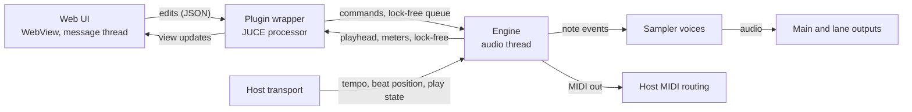

# Furrow plugin: spec and plan

Oct 25, 2026 · No Chaserz

**Status.** Draft. Nothing in this document has been built or host-tested yet. It describes the VST3 and CLAP edition of Furrow and the order in which it will be built. The REAPER edition in `jsfx/` and `lua/` stays supported, and [Furrow-Spec-and-Architecture.md](../../Furrow-Spec-and-Architecture.md) remains the authority for musical behaviour that both editions share.

## Overview

The Furrow plugin is a step sequencer and drum sampler that loads as an instrument in any VST3 or CLAP host. It keeps the REAPER edition's Channel Rack workflow: drop samples, click steps, hear the beat. Each lane plays either a sample inside the plugin or MIDI out to another instrument.

The REAPER edition gets much of its power from controlling REAPER. It creates tracks, adds RS5K, sets up routing and writes MIDI items. A plugin cannot do any of that in another host. The plugin therefore brings the sampler inside, sends MIDI out for instrument lanes, and moves patterns in and out of the host by drag and drop.

**Goals**

- Program a drum beat as fast as in FL Studio's Channel Rack, in REAPER, Studio One and FL Studio.
- Match the REAPER edition's sequencing behaviour exactly, checked by shared test vectors.
- Give it a modern, graphical interface that makes the grid the centre of attention and stays fast at 64 lanes.
- Ship free and open source.

**Non-goals for now**

- AU and AAX formats. None of the target hosts requires them.
- Replacing the REAPER edition. The two editions are siblings.
- A full sampler with multisamples, effects or time-stretching. Each sample lane plays one sample.
- Song mode inside the plugin. The host's arrangement does that job.

**Target hosts.** REAPER, PreSonus Studio One and FL Studio, on Windows, macOS and Linux where the host runs. Studio One and FL Studio are not available on Linux. The development machine runs Linux with REAPER only, so REAPER on Linux is the first host tested. Studio One and FL Studio checks need a Windows or macOS machine. Every host and platform pair needs its own test evidence before it is listed as supported.

## Licence

The plugin is built on JUCE 9 under AGPLv3, so everything under `plugin/` is licensed AGPLv3. The REAPER edition stays MIT. The Steinberg VST3 SDK and the CLAP SDK are both MIT-licensed. Distributing a binary requires offering its complete source under AGPLv3, which the public repository does.

## Formats and frameworks

| Item | Choice | Why |
| --- | --- | --- |
| Plugin formats | VST3 and CLAP, plus a standalone app for development | All three target hosts load VST3. REAPER and Studio One also load CLAP. |
| Framework | JUCE 9, pinned to an exact release (9.0.4 at the spike) | Mature, cross-platform, best Linux support among the main frameworks, built-in WebView UI support |
| CLAP | `clap-juce-extensions`, pinned to a commit | JUCE 9 has no native CLAP target. The project publishes from `main` rather than tagged releases. |
| Language | C++20 | Supported by JUCE 9 and the three platform toolchains |
| Build | CMake, with dependencies fetched at pinned versions | One build description for all platforms and CI |
| UI | Web front-end in JUCE's WebView, with the step grid drawn on a `<canvas>` | Fast iteration on visual design; canvas keeps 64 × 512 cells smooth |

## What carries over from the REAPER edition

| REAPER edition | Plugin |
| --- | --- |
| SeqCore schedules notes on the audio thread | The C++ engine schedules notes on the audio thread, using the same rules |
| Sample lane: a REAPER track with RS5K | Sample lane: a sample voice inside the plugin |
| Instrument lane: MIDI to a chosen track and channel | MIDI lane: MIDI out of the plugin on a chosen channel; the host routes it |
| Commit to MIDI items | Drag a pattern, or one lane, from the plugin onto the host timeline as a `.mid` file |
| Capture from a MIDI item | Drop a `.mid` file onto the plugin; the same conversion preview and refusal rules apply |
| Live and Items modes | Not needed. The host plays dragged MIDI on its own track. |
| gmem mailbox, slots, coordinator | Not needed. UI and engine share a process and talk through lock-free queues. |
| REAPER undo | Undo and redo inside the plugin. Host undo does not cover plugin internals. |
| State in `@serialize` | State in the host's plugin chunk, with the same versioned format rules |
| Panic | Panic button, plus release of every voice and held MIDI note on stop, bypass and reset |

## Version 1 scope

V1 matches the REAPER edition's V1 musical scope, so the two editions stay comparable.

| Feature | Behaviour |
| --- | --- |
| Lanes | Up to 64. Name, colour, mute, solo, volume, pan, output. |
| Lane target | Sample (plays inside the plugin) or MIDI (channel 1 to 16 out of the plugin). |
| Sample lanes | Drop audio files to add lanes. WAV, AIFF and FLAC. Start, end, pitch, attack and decay, choke group. |
| Steps | 1 to 512 per lane, independent lane lengths. Click toggles, drag paints, right-drag erases, Shift-drag sets velocity. |
| Step lanes | Velocity, release velocity, pitch, fine pitch, pan, Mod A, Mod B, shift, gate, ratchet, probability. |
| Swing | Global swing times per-lane swing amount, with optional truncation. |
| Patterns | Up to 256. Switch at the next bar while playing; clone, clear, rename. |
| Tools | Fill every 2, 3, 4 or 8. Rotate, invert, clear. |
| Probability | The shared seeded hash. Same seed and position give the same result in both editions. |
| MIDI drag out | Drag a pattern or lane to the host as a `.mid` file rendered from the start of the pattern. |
| MIDI drop in | Convert a `.mid` file into a new pattern, with a preview. |
| Kits and presets | Save and load a kit: lanes, samples and settings. Patterns save with the host project. |
| Outputs | A stereo main output, plus optional per-lane stereo outputs for mixing in the host. |

The REAPER edition's V2 and V3 features (conditions, per-lane rate and direction, parameter locks, generators) apply to both editions when they arrive. Parameter locks will target the plugin's own sampler parameters in this edition, because a plugin cannot reach other plugins' parameters.

## Architecture



### Components

| Component | Folder | Runs on | Does |
| --- | --- | --- | --- |
| Engine | `plugin/engine/` | Audio thread | Owns the active musical state while playing. Follows the host transport and turns steps into timed events. No JUCE or platform code, so it builds and tests on its own. |
| Sampler | `plugin/sampler/` | Audio thread | Plays sample voices from preloaded buffers. Handles choke groups, envelopes and output assignment. |
| Wrapper | `plugin/src/` | Both | The JUCE processor and editor. Bridges host I/O, parameters, state and the UI. Loads samples on a background thread. |
| Web UI | `plugin/ui/` | Message thread, inside the WebView | Draws the rack and turns input into edit messages. Never touches audio. |
| Tests | `plugin/tests/` | CI | Engine unit tests, golden tests against the REAPER edition's references, state round-trip tests. |

### Threading and real-time rules

The audio callback must never wait. These rules apply to everything that runs on the audio thread, and code review checks them.

- No memory allocation or release. All voices, queues, event buffers and pattern storage are allocated before playback.
- No locks, no file or network access, no logging, no waiting on the message thread.
- The UI and wrapper send edits through a bounded single-producer, single-consumer queue. A full queue rejects the edit visibly on the message thread; it never blocks the audio thread.
- Large changes, such as a new sample or a whole pattern from a MIDI drop, are built off the audio thread and handed over as one prepared object. The old object is released on the message thread.
- The engine publishes playhead and meter values through a second lock-free channel. The UI reads the newest value and skips stale ones.

### Pattern storage

The engine keeps the REAPER edition's 16-step page model, with pages taken from a preallocated pool. A dense array of every step in every pattern would need 256 × 64 × 512 × 16 values, about 134 million, which is far too much memory. Pages whose steps all match defaults use no pool entry. The pool limits from the shared spec apply, with the same preflight and capacity-error rules. Values are 32-bit, because a gate reaches 160,000, so the pool, page table and preflight marks take about 21 MB per instance, allocated when the plugin loads. A smaller layout can come later if several instances prove a problem; it must keep the same limits and save order.

### Timing

The timing rules in the shared spec carry over unchanged: schedule in project beats, convert due events to sample offsets, use the pattern origin for phase, and release and cancel on seek or loop wrap. The engine reads tempo, beat position and play state from the host at the start of each block, as SeqCore does in REAPER. How each target host reports tempo ramps, loop wraps and position inside a block has to be measured per host, as milestone 1 did for REAPER 7.82. Until it is, the one-sample target is a REAPER claim only.

Hosts may split a block or call the plugin with very small or zero-length blocks. The engine must handle any block size from 0 to the maximum the host announced.

### MIDI out

Each MIDI lane sends on its own MIDI channel from the plugin's single MIDI output. The host routes that output to the receiving instrument. REAPER, Studio One and FL Studio each expose plugin MIDI output differently. The first spike measures each one. The plugin's documentation then gives exact routing steps per host. Until that evidence exists, MIDI lanes are not claimed to work in a given host.

### State and file formats

| Data | Saved where | How |
| --- | --- | --- |
| Lanes, patterns, steps, settings | Host plugin state | The tag `FRWS`, a container version, the Tones switch, then SeqCore's state format 1: sparse records, each word a 32-bit little-endian float. That payload is byte for byte what the REAPER edition saves. |
| Sample references | Host plugin state | Absolute path, path relative to the project when the host provides one, and a content hash so a moved file can be found again |
| Kits | `.furrowkit` files | Lane settings and sample references, chosen by the user |
| Exported patterns | `.mid` files | Standard MIDI file, type 1, one track per lane |

Loading rejects truncated, unsupported or over-capacity state with a visible error. It never replaces a rack with an empty one without saying so. As in SeqCore, a Furrow state the engine cannot read is kept, written back unchanged on the next save, and leaves playback silent and edits refused until a good state loads. Data without the `FRWS` tag is not a Furrow state and is ignored. The visible error arrives with the interface. A missing sample keeps its lane, shows it as missing and offers to find it.

## Interface

The interface has to make the grid the first thing a person reads and the fastest thing to use. The clickable prototype in `plugin/ui/prototype/` explores the layout and look before any plugin code exists.

**Layout.**

```
┌────────────────────────────────────────────────────────────────────┐
│ Furrow   Pattern ▾   ▶  120 BPM   Swing   Seed                     │  top bar
├──────────────┬───────────────────────────────────────┬─────────────┤
│ Lanes        │ Step grid, beats grouped by four,      │ Inspector   │
│ name, M, S,  │ moving playhead                        │ selected    │
│ volume       │                                        │ lane        │
├──────────────┴───────────────────────────────────────┴─────────────┤
│ Step lane editor: Velocity · Probability · Pitch · Gate · Ratchet   │
└────────────────────────────────────────────────────────────────────┘
```

**Principles.**

- The grid is the one bold element. A step's fill height shows its velocity, its opacity shows its probability, and ratchets show as divisions inside the cell. A person can read a pattern's feel without opening an editor.
- Every lane has its own colour, carried from the lane name through its steps and its bars in the editor.
- Every action from the REAPER edition stays reachable by mouse and keyboard. Keyboard focus is always visible.
- Motion only answers an action or shows playback. The playhead moves; nothing else animates on its own.
- The window resizes freely and scales for HiDPI displays. The grid scrolls rather than shrinking cells below a usable size.
- Text follows the copy rules in the shared spec: plain verbs, sentence case, errors that say what went wrong and how to fix it.

## Testing

- **Engine unit tests** for each rule: swing, shift, ratchets, gate, probability, pattern switch, seek, loop wrap and lane length.
- **Golden tests against the REAPER edition.** `plugin/tests/golden/make_golden.py` runs SeqCore in ysfx through scenarios covering every V1 rule and records each block's transport input, every MIDI event, every transaction result, the playheads and the final saved words. The engine replays the same input and must match exactly: same events, same samples, same saved words. The probability hash test vectors, the 27 fresh REAPER 7.82 captures and `probes/expected/constant-120.txt` are checked too. When SeqCore changes, regenerate the traces; the tests then fail until the engine agrees. CI regenerates the traces on every change and fails if they differ from the committed ones, so a SeqCore change cannot go untested.
- **Mutation checks.** A deliberate bug in each rule (swing, shift, ratchets, truncation, release order, pattern-switch boundary, seek and ramp detection, controller rest, probability step rounding, audition length, save order, load checks) must make a test fail. Milestone 2 ran 17 such mutations.
- **Real-time safety.** A test build fails if the audio callback allocates memory. Address and undefined-behaviour sanitizer builds run in CI.
- **Host validation.** `pluginval` at its strictest level in CI on Windows, macOS and Linux, plus the Steinberg VST3 validator and `clap-validator`. `.github/workflows/plugin.yml` runs them on every change to the plugin and keeps each platform's build as a downloadable artifact for 30 days.
- **Host checks.** Recorded evidence per host and platform for transport sync, MIDI out, state save and reload, and MIDI drag and drop. The REAPER bridge in `tools/reaper_bridge/` can drive the REAPER checks.

## Engine decisions

Milestone 2 ported SeqCore's V1 rules to `plugin/engine/`. The engine matches SeqCore's output exactly, with these deliberate differences, each because the plugin is not a JSFX inside REAPER:

- **No live hold.** SeqCore waits two blocks before playing after a load or a return to Live mode, so REAPER's item gate can close. The plugin has no item gate, and a host that does not process while stopped would lose the downbeat, so the plugin passes a hold of 0. The golden tests pass 2.
- **Live and Items modes.** The rack's mode is kept so a saved state round-trips, but the plugin never selects Items mode.
- **Host input.** An empty block changes nothing. A block without a finite position, a positive tempo or a sample rate counts as stopped. A host reset releases every held note at the start of the next block.
- **Stricter loading.** State words must be whole numbers, and the origin's four words must be 16-bit and give a finite beat. SeqCore accepts near-whole numbers and does not check the origin.
- **MIDI channels.** The engine reports a lane, not a channel. Until lanes choose their own output, the development plugin sends lane n on channel n mod 16 + 1.
- **Exact arithmetic.** The engine is built with floating-point contraction off, so each multiply and add rounds as SeqCore's do. A fused multiply-add would change the last bits of timing on some platforms.
- **Threading, for now.** The engine belongs to the audio thread. Until milestone 4 adds a message-thread copy of the rack and a lock-free handover, saving and loading hold JUCE's callback lock, so the audio thread waits for them.

Carried over as SeqCore has it, to revisit with the REAPER edition: a waiting hit or release at a negative beat counts as none, so a pattern whose origin is before beat 0 drops hits there. Origins before beat 0 need a stopped switch with the cursor before the project start.

## Build plan

Each milestone ends with recorded evidence before the next one starts, as in the REAPER edition.

1. **Spike.** A bare plugin with no UI that plays one fixed 16-step, four-lane pattern in sync with the host, as MIDI out and as simple built-in tones. Load it in REAPER on Linux first and record how it reports transport and routes plugin MIDI output. This settles the toolchain. Studio One and FL Studio need a Windows or macOS machine; their spike checks run when one is available, and CI builds the Windows and macOS binaries for them.
2. **Engine.** Port SeqCore's V1 rules to `plugin/engine/` test-first, with the golden tests passing.
3. **Sampler.** Sample loading off the audio thread, voices, choke groups and lane outputs.
4. **Interface.** Build the agreed prototype design in the WebView and connect it to the engine through the wrapper.
5. **Product features.** Undo and redo, kits, MIDI drag out and drop in, missing-sample recovery, resizing.
6. **Release.** Installers for Windows, macOS and Linux, macOS signing and notarization, Windows signing, CI artifacts and user documentation.

## Open questions

- How does each target host report tempo ramps and loop wraps inside a block?
- How does each target host route plugin MIDI output, and does any of them limit it?
- Does FL Studio's VST3 wrapper accept a `.mid` drag from a plugin window, or does it need a different drag format?
- How does JUCE's WebView perform on Linux (WebKitGTK) with a 64-lane grid?
- What should the default kit be, and can its samples be distributed under a licence compatible with AGPLv3?
- The shared spec notes that the Furrow name needs a trademark check before release. That applies to the plugin too.
